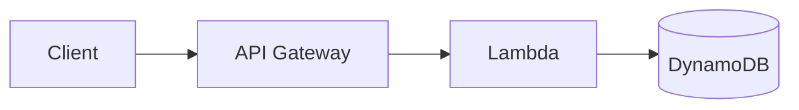

# Design: {{システム名}}

> requirements.md の各要件をどう実現するかの技術仕様。
> 憲法（AWS 前提 / サーバレス優先 / TDD）に従う。憲法から外れる判断は ADR を参照する。

## 1. アーキテクチャ概要

{{全体構成図。Mermaid で記述する}}

## 2. 技術スタック

| レイヤ | 選定 | 選定理由 | 検討した代替案 |
|--------|------|----------|----------------|
| 言語 / ランタイム | {{}} | {{}} | {{}} |
| コンピュート | {{Lambda など}} | {{}} | {{}} |
| データストア | {{DynamoDB など}} | {{}} | {{}} |
| IaC | {{AWS CDK など}} | {{}} | {{}} |
| テスト | {{フレームワーク}} | {{}} | {{}} |

## 3. コンポーネント設計

### 3.1 {{コンポーネント名}}

- **責務**: {{}}
- **対応要件**: REQ-xxx, REQ-yyy
- **インターフェース**: {{入出力・API シグネチャ}}
- **依存**: {{}}

## 4. データモデル

{{テーブル定義・キー設計・アクセスパターン}}

| テーブル | PK | SK | 属性 | アクセスパターン |
|----------|----|----|------|------------------|
| {{}} | {{}} | {{}} | {{}} | {{}} |

## 5. API / インターフェース定義

| メソッド | パス | 入力 | 出力 | 対応要件 |
|----------|------|------|------|----------|
| {{}} | {{}} | {{}} | {{}} | REQ-xxx |

## 6. エラーハンドリング

| 状況 | 振る舞い | 対応要件 |
|------|----------|----------|
| {{}} | {{}} | {{}} |

## 7. セキュリティ

- 認証・認可: {{IAM / Cognito など}}
- MCP の OAuth 2.1（Cognito を認可サーバにする場合のみ）:
  - Cognito は（2026-09 時点）RFC 8414 メタデータと DCR を持たず、`openid-configuration` に `code_challenge_methods_supported` も無い（Claude Code は PKCE 非対応とみなして失敗する）。MCP サーバと同一オリジンで `/.well-known/oauth-protected-resource` と `/.well-known/oauth-authorization-server`（`code_challenge_methods_supported: ["S256"]` を明示）を返し、client ID とコールバック URL は事前登録する。
  - PRM の `authorization_servers` はパス無しの URL にする（パス付きだと well-known はパスの前に挿入して探される。API Gateway REST API はステージパスが付くため独自ドメインが要る）。
  - MCP サーバの URL（PRM の `resource`）を識別子にしたリソースサーバを登録する。未登録だと、authorize に `resource` を付けたフローの token 交換が `invalid_grant` になる。検証は well-known の確認で終えず、`resource` 付きの認可コードフローを token 交換まで通す。
  - 401 の `WWW-Authenticate` は自前の PRM を指す。前段の CloudFront でオリジンの 401 を書き換えることはできない（viewer-response 関数はオリジンの 4xx/5xx で呼ばれない）ため、viewer-request で先に 401 を返す。
- シークレット管理: {{Secrets Manager / SSM}}
- 最小権限: {{}}

## 8. コスト概算

| リソース | 想定利用量 | 月額概算 (USD) |
|----------|-----------|----------------|
| {{}} | {{}} | {{}} |
| **合計** | | {{}} |

## 9. テスト戦略

- ユニット (`npm test`): {{対象・モック方針}}
- 統合: {{DynamoDB Local / LocalStack / テストスタック}}
- 正常性テスト (`npm run test:smoke`): デプロイ後に dev / prod へ実行する。対象ユースケース:
  - {{REQ-xxx: 主要ユースケース 1}}
  - {{REQ-xxx: 主要ユースケース 2}}

### 環境とデプロイ経路

| stage | AWS アカウント | トリガ | 昇格条件 |
|-------|----------------|--------|----------|
| dev | {{account id}} | `develop` への push | 正常性テスト通過で `main` へ fast-forward |
| prod | {{account id}} | `main` 更新 | Environment `production` の承認 {{あり / なし}} |

CDK は `--context stage=<dev|prod>` でスタック名とパラメータを切り替える。詳細は `.github/workflows/README.md`。

## 10. 要件トレーサビリティ

| 要件 ID | 実現コンポーネント | 検証方法 |
|---------|-------------------|----------|
| REQ-001 | {{}} | {{}} |

## 11. 関連 ADR

- [ADR-0001](../adr/0001-{{slug}}.md): {{タイトル}}
